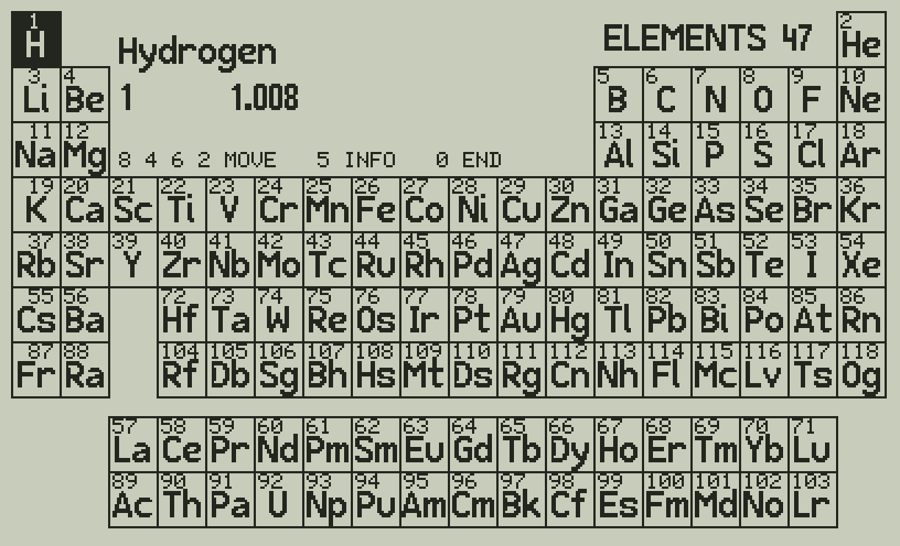
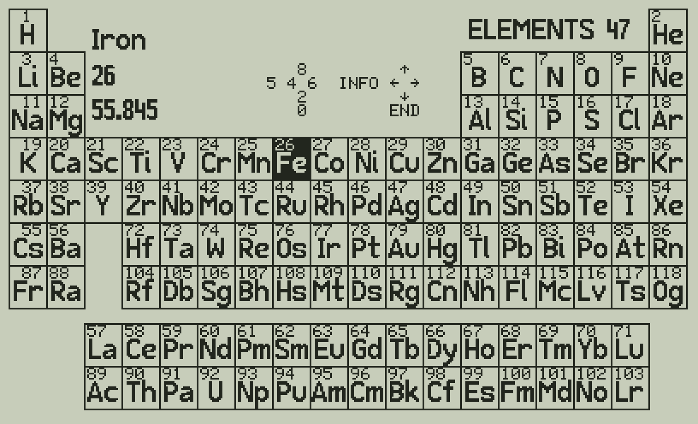
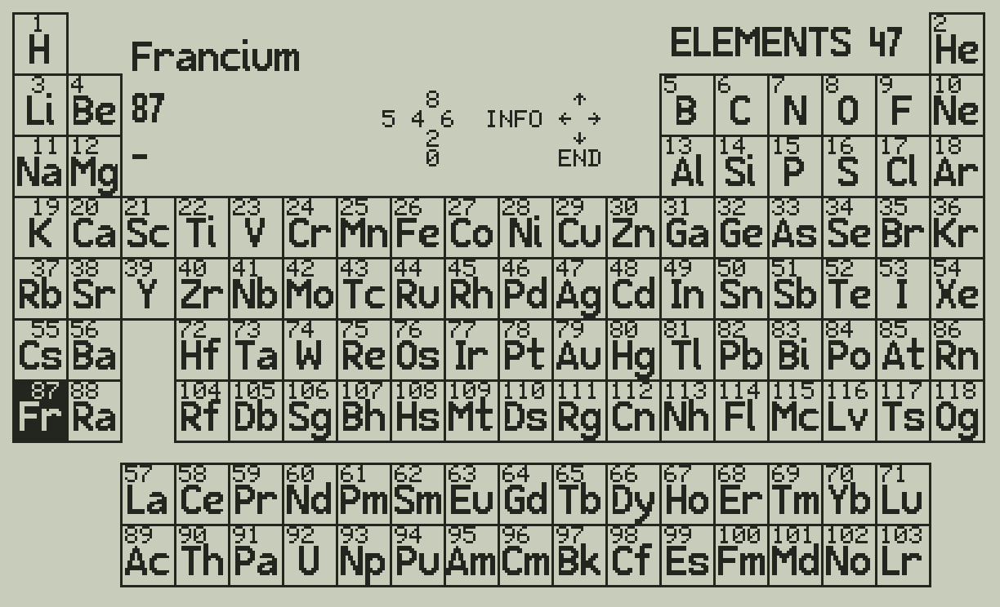
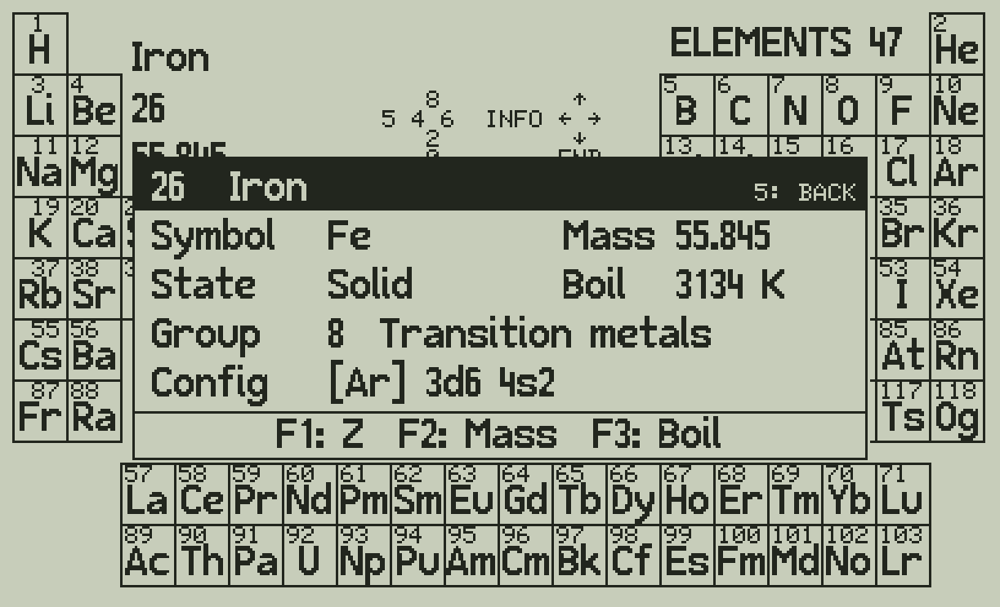
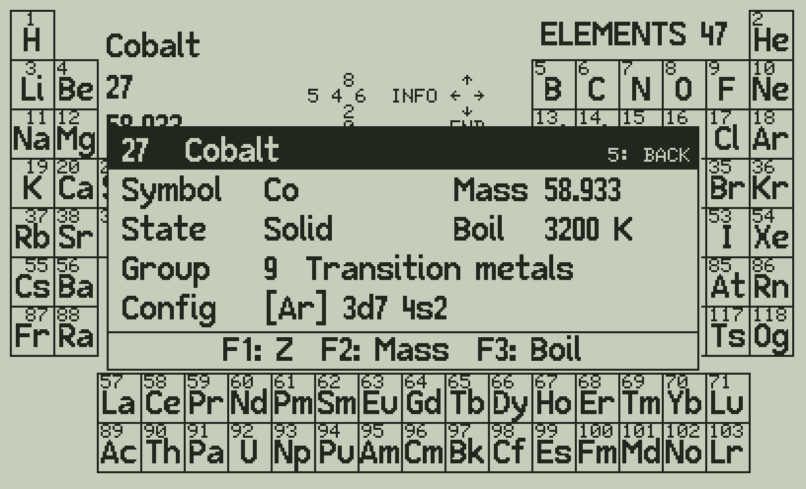
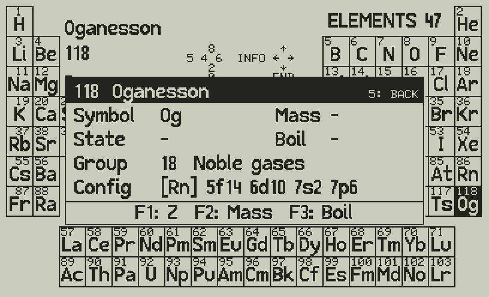

# Elements 47 v1.2.0: user's manual

The periodic table of the 118 elements on the C47 / R47: the table on one screen, a cursor you move with the
digit keys, and a detail box for each element.

## Install

- You need a C47 or R47 with the firmware 00.109.05.00a0.ALPHA (5 Oct 2026) or later: it has the
  structured programming commands (IF, DO, REPEAT: app note AN0007), ATEXT, GRFNT and PIXEL.
- From the release zip, copy `C47_R47/ELEM47.p47` to the calculator (USB disk) and load it as any other
  program. It holds three programs: `ELEM47` (the one you run), `ELD1` and `ELD2` (the element data).
- ELEM47 keeps your stack (4 or 8 levels) and LASTx, and the registers outside R20-R56. It uses R20-R56
  for its work and clears them at the end: keep nothing you need there.

## Start

`XEQ "ELEM47"`. After a few seconds the table is on the screen, the cursor on H (hydrogen).

- Rows 1-7 are the periods, the two rows below them the lanthanides and the actinides.
- Each cell shows the atomic number (small) and the symbol.
- The empty part of periods 1-3 shows the title, the selected element (name, atomic number, standard atomic
  weight) and the keys: the digit keys on the left, what they do on the right.

## Move the cursor

| Key | |
|---|---|
| **8** | up |
| **2** | down |
| **4** | left |
| **6** | right |

The cursor jumps over empty cells, and the panel shows the new element. Three times **2** and seven times
**6** from H:

At an edge the cursor goes around to the other side: **8** on H goes to the bottom of column 1, Fr; **4** on
H goes to He; **2** on Ac goes up to Sc.

## The detail box

**5** opens the box of the element under the cursor: symbol, standard atomic weight, state at room
temperature, boiling point, group with its name, and the electron configuration.

With the box open, **8 4 6 2** move the cursor as before and the box shows the new element at once
(here **6**: from Fe to Co). **5** closes the box, **0** ends; other keys are ignored.

The keys under the line at the bottom of the box: **F1**, **F2** or **F3** ends ELEM47 and puts a value of the element in X,
on top of your stack: **F1** the atomic number, **F2** the standard atomic weight, **F3** the boiling point in
kelvin. A value shown as "-" is not put: ELEM47 ends with your stack as it was.

The longest configuration, Og (oganesson):

"-" in a field: no value (the 34 elements without a standard atomic weight, or no data in PubChem).

## End

**0** ends ELEM47: the normal calculator screen comes back with your stack and LASTx as they were, R20-R56
cleared and the matrix PT (the table's map) deleted. **F1 F2 F3** in the detail box end it the same way, with
the value of the element pushed on the stack (the top level goes, as for any number you key in).

## Keys

| Key | Table | Detail box open |
|---|---|---|
| **8 4 6 2** | move the cursor | move, the box of the new element |
| **5** | open the box | close the box |
| **0** | end | end |
| **F1 F2 F3** | - | end, Z / mass / boiling point to X |

## Where the data come from

Standard atomic weights: IUPAC / CIAAW 2024 (abridged, as on the IUPAC periodic table). State, boiling point,
electron configuration: the PubChem periodic table. See `NOTICE`.

## Which calculators

ELEM47 needs three commands of the C47 firmware: the structured programming commands (IF, DO, REPEAT),
ATEXT and GRFNT.

- **R47 and DM42n** with the C47 firmware 00.109.05.00a0.ALPHA (5 Oct 2026) or later: yes.
- **Original DM42 (not n)** with the C47 firmware 00.109.05.00a0.ALPHA or later, **packages 1, 2 or 3**: it
  should run, but slower than on the DM42n or R47 (older hardware). Its firmware is cut down to fit its flash:
  the structured commands allow only 10 IF, 10 DO and 10 REPEAT per program there, and ELEM47 keeps within that.
  **Package 4** has no structured commands: no. The DM42 packages change between builds to save space, so check
  again after a firmware update. Nobody has tried ELEM47 on an original DM42 yet.
- **Older C47 firmware** (00.109.04.00b0 and earlier): no, it has none of the three.
- **DM42 / DM42n with the stock firmware, or Free42:** use the release v1.0.0 (`Free42_DM42/ELEM47.raw`):
  the same table and keys, without going around the edges.
